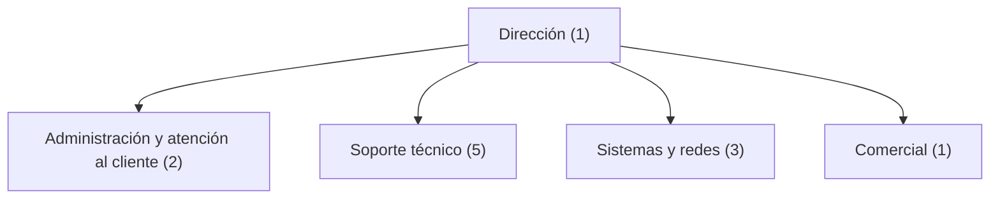

# 2. Departamentos y estructura organizativa

## 2.1. Organización interna

TecnoVal Asistencia IT tiene una plantilla ficticia de 12 trabajadores. La empresa se divide en cinco áreas: dirección, administración y atención al cliente, soporte técnico, sistemas y redes, y comercial.

## 2.2. Departamentos, funciones y número de trabajadores

| Departamento | Trabajadores | Funciones principales |
|---|---:|---|
| Dirección | 1 | Coordinar la empresa, tomar decisiones, controlar los objetivos y supervisar los resultados. |
| Administración y atención al cliente | 2 | Gestionar facturas, presupuestos, citas, correos, contratos y registros de incidencias. |
| Soporte técnico | 5 | Diagnosticar y resolver averías, preparar equipos, instalar aplicaciones y atender a los clientes. |
| Sistemas y redes | 3 | Configurar redes, administrar servidores, gestionar copias de seguridad y aplicar medidas de seguridad. |
| Comercial | 1 | Buscar clientes, presentar servicios, preparar propuestas comerciales y hacer seguimiento de las oportunidades. |
| **Total** | **12** | |

## 2.3. Puestos de trabajo y responsabilidades

### Dirección — 1 persona

- Organiza el trabajo de los departamentos.
- Decide las prioridades y los objetivos.
- Supervisa los resultados económicos y la calidad del servicio.
- Aprueba las compras importantes y los contratos.

### Administración y atención al cliente — 2 personas

- Registra las solicitudes de los clientes.
- Organiza las citas de los técnicos.
- Gestiona facturas, presupuestos y documentación.
- Informa a los clientes sobre el estado de las incidencias.

### Soporte técnico — 5 personas

- Revisa y repara ordenadores y periféricos.
- Instala sistemas operativos y aplicaciones.
- Atiende incidencias presenciales y remotas.
- Documenta las actuaciones realizadas.
- Deriva las incidencias de red o servidor al departamento correspondiente.

### Sistemas y redes — 3 personas

- Configura routers, switches y puntos de acceso.
- Administra los servidores y los servicios compartidos.
- Configura y comprueba las copias de seguridad.
- Gestiona las cuentas, los permisos y las actualizaciones de los sistemas.
- Da soporte a incidencias técnicas complejas.

### Comercial — 1 persona

- Contacta con posibles clientes.
- Explica los servicios y prepara propuestas.
- Mantiene la relación comercial con los clientes.
- Coordina con dirección las necesidades y oportunidades de negocio.

## 2.4. Organigrama

El siguiente organigrama está escrito en Mermaid, un formato de diagramas que GitHub puede mostrar dentro de los archivos Markdown.

## 2.5. Justificación de la estructura

El departamento de soporte técnico es el más numeroso porque la actividad principal de la empresa es resolver incidencias y mantener equipos informáticos de diferentes clientes. Sistemas y redes necesita personal especializado para las tareas de servidor, conectividad y copias de seguridad. Administración y atención al cliente organiza las peticiones y la documentación, mientras que la persona comercial busca nuevos contratos. La dirección coordina todas las áreas.

Esta estructura es suficientemente sencilla para una empresa de 12 personas y está relacionada con los servicios que ofrece.
