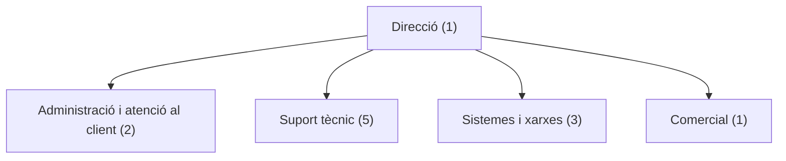

# 2. Departaments i estructura organitzativa

## 2.1. Organització interna

TecnoVal Assistència IT té una plantilla fictícia de 12 treballadors. L'empresa es divideix en cinc àrees: direcció, administració i atenció al client, suport tècnic, sistemes i xarxes, i comercial.

## 2.2. Departaments, funcions i nombre de treballadors

| Departament | Treballadors | Funcions principals |
|---|---:|---|
| Direcció | 1 | Coordinar l'empresa, prendre decisions, controlar els objectius i supervisar els resultats. |
| Administració i atenció al client | 2 | Gestionar factures, pressupostos, cites, correus, contractes i registres d'incidències. |
| Suport tècnic | 5 | Diagnosticar i resoldre avaries, preparar equips, instal·lar aplicacions i atendre els clients. |
| Sistemes i xarxes | 3 | Configurar xarxes, administrar servidors, gestionar còpies de seguretat i aplicar mesures de seguretat. |
| Comercial | 1 | Buscar clients, presentar serveis, preparar propostes comercials i fer seguiment de les oportunitats. |
| **Total** | **12** | |

## 2.3. Llocs de treball i responsabilitats

### Direcció — 1 persona

- Organitza el treball dels departaments.
- Decideix les prioritats i els objectius.
- Supervisa els resultats econòmics i la qualitat del servei.
- Aprova les compres importants i els contractes.

### Administració i atenció al client — 2 persones

- Registra les sol·licituds dels clients.
- Organitza les cites dels tècnics.
- Gestiona factures, pressupostos i documentació.
- Informa els clients sobre l'estat de les incidències.

### Suport tècnic — 5 persones

- Revisa i repara ordinadors i perifèrics.
- Instal·la sistemes operatius i aplicacions.
- Atén incidències presencials i remotes.
- Documenta les actuacions realitzades.
- Deriva les incidències de xarxa o servidor al departament corresponent.

### Sistemes i xarxes — 3 persones

- Configura routers, switches i punts d'accés.
- Administra els servidors i els serveis compartits.
- Configura i comprova les còpies de seguretat.
- Gestiona els comptes, permisos i actualitzacions dels sistemes.
- Dona suport a incidències tècniques complexes.

### Comercial — 1 persona

- Contacta amb possibles clients.
- Explica els serveis i prepara propostes.
- Manté la relació comercial amb els clients.
- Coordina amb direcció les necessitats i oportunitats de negoci.

## 2.4. Organigrama

El següent organigrama està escrit en Mermaid, un format de diagrames que GitHub pot mostrar dins dels fitxers Markdown.

## 2.5. Justificació de l'estructura

El departament de suport tècnic és el més nombrós perquè l'activitat principal de l'empresa és resoldre incidències i mantindre equips informàtics de clients diferents. Sistemes i xarxes necessita personal especialitzat per a les tasques de servidor, connectivitat i còpies de seguretat. Administració i atenció al client organitza les peticions i la documentació, mentre que la persona comercial busca nous contractes. La direcció coordina totes les àrees.

Aquesta estructura és prou senzilla per a una empresa de 12 persones i està relacionada amb els serveis que ofereix.
