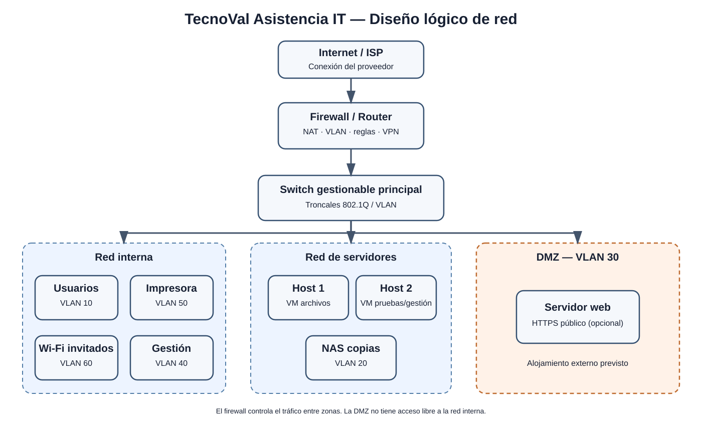

# 3. Diseño de la red

## 3.1. Topología propuesta
El diseño utiliza una topología en estrella: los equipos se conectan a switches gestionables y estos se enlazan con el firewall/router. El firewall controla el acceso a Internet y el tráfico entre VLAN.

## 3.2. Componentes principales

| Componente | Cantidad | Función |
|---|---:|---|
| Firewall/router | 1 | Conexión a Internet, reglas de seguridad, enrutamiento entre VLAN y VPN si se configura. |
| Switch gestionable principal | 1 | Conectar servidores y distribuir VLAN. |
| Switch gestionable de acceso | 1 | Conectar puestos, impresora y puntos de acceso. |
| Hosts de virtualización | 2 | Ejecutar servicios internos en máquinas virtuales separadas. |
| NAS de copias | 1 | Guardar copias de seguridad. |
| Puntos de acceso Wi-Fi | 2 | Wi-Fi corporativo y de invitados con redes separadas. |
| Impresora multifunción | 1 | Impresión y digitalización compartidas. |
| Servidor web | 1 lógico | Publicar la web desde DMZ si se aloja en la empresa. Inicialmente se prevé alojamiento externo. |
| Puestos de trabajo | 12 | Equipos de los trabajadores. |

## 3.3. Zonas y conexiones
- **Internet:** conexión del proveedor hacia el firewall.
- **Red interna:** ordenadores de departamentos y recursos internos.
- **Red de servidores:** máquinas virtuales de archivos, gestión y pruebas.
- **DMZ:** zona separada para servicios accesibles desde Internet, como un servidor web propio. No tendrá acceso libre a la red interna.
- **Red de gestión:** acceso administrativo restringido a dispositivos de red y servidores.
- **Wi-Fi de invitados:** acceso a Internet sin acceso a equipos, impresoras ni servidores internos.

## 3.4. Servicios previstos en la DMZ
La DMZ se reserva para un servidor web público si se decide alojar la web en las instalaciones. Solo se publicarían los puertos necesarios para el servicio web (HTTP/HTTPS, preferiblemente HTTPS). El firewall bloqueará las conexiones desde la DMZ hacia redes internas salvo excepciones justificadas. La administración se realizará desde la red de gestión, no directamente desde Internet.

Como la alternativa seleccionada es contratar alojamiento web externo, la DMZ puede permanecer preparada sin servidor público propio durante la primera fase. No se publicará un servidor interno directamente en Internet.

## 3.5. Decisiones técnicas
1. Switches gestionables para configurar VLAN.
2. Separar usuarios, servidores, impresoras, gestión, invitados y DMZ.
3. Centralizar en el firewall el enrutamiento y las reglas.
4. Conexiones cableadas para puestos fijos y servidores.
5. Wi-Fi corporativo para dispositivos autorizados y SSID de invitados aislado.
6. NAS de copias con acceso restringido.
7. Documentar reglas, conexiones y direcciones IP.

## 3.6. Fuentes técnicas
- [IEEE 802.1Q – estándar de VLAN](https://standards.ieee.org/ieee/802.1Q/6844/).
- [Cisco – VLAN y redes LAN](https://www.cisco.com/c/en/us/solutions/enterprise-networks/what-is-a-lan-local-area-network.html).
- [NIST SP 800-41 Rev. 1 – Guidelines on Firewalls and Firewall Policy](https://csrc.nist.gov/pubs/sp/800/41/r1/final).
- [Proxmox VE – documentación oficial](https://pve.proxmox.com/pve-docs/).
