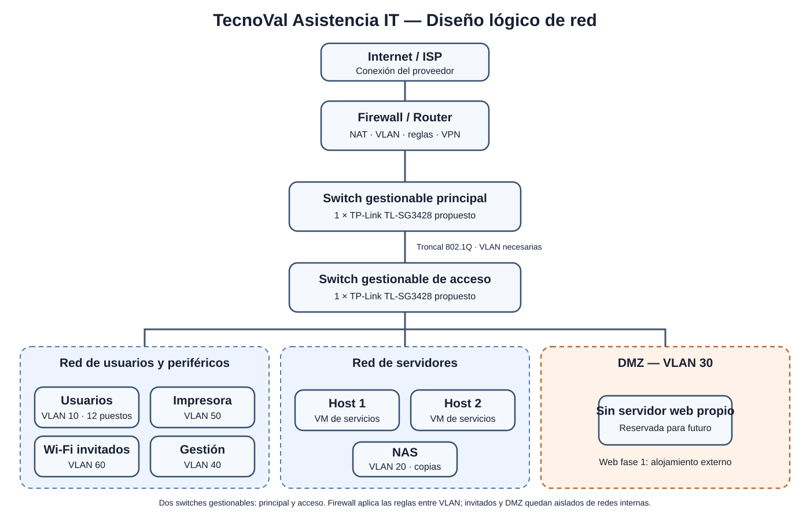

# 3. Diseño de la red

## 3.1. Topología propuesta

La topología física será en estrella. El firewall/router conectará con el switch gestionable principal. Este switch enlazará con el segundo switch mediante un enlace troncal 802.1Q. Los puestos, servidores, NAS, impresora y puntos de acceso se conectarán a los puertos de acceso correspondientes.

## 3.2. Componentes principales

| Componente | Cantidad | Función y conexión |
|---|---:|---|
| Firewall/router | 1 | Conexión a Internet, NAT, VPN y reglas entre VLAN. Conectado al switch principal mediante enlace troncal si el modelo admite subinterfaces VLAN. |
| Switch gestionable principal TP-Link TL-SG3428 (propuesto) | 1 | Núcleo de distribución: conecta firewall, Host 1, NAS y enlace troncal hacia el switch de acceso. |
| Switch gestionable de acceso TP-Link TL-SG3428 (propuesto) | 1 | Conecta puestos, impresora y puntos de acceso. El enlace al switch principal transporta las VLAN necesarias. |
| Hosts de virtualización | 2 | Ejecutan máquinas virtuales separadas; se conectan al switch principal. |
| NAS QNAP TS-464-8G (propuesto) | 1 | Almacenamiento compartido y destino de copias; se conecta a la red de servidores. Sus dos puertos 2,5GbE no implican que los switches propuestos sean multigigabit; la conexión funcionará a la velocidad negociada. |
| Puntos de acceso Wi-Fi 6 | 2 | SSID corporativo e invitados asociados a VLAN diferentes. Confirmar si requieren PoE y si los switches seleccionados lo proporcionan; si no, incluir inyectores o alimentación. |
| Impresora multifunción | 1 | Conectada a VLAN 50. |
| Servidor web propio | 0 en primera fase | La web estará en alojamiento externo; no se instala un servidor web en la DMZ en esta fase. |
| Correo corporativo | 1 servicio externo | Doce cuentas gestionadas con dominio propio, MFA y antispam. No se aloja un servidor de correo en la DMZ. |

## 3.3. Zonas y conexiones

- **Internet:** conexión del proveedor hacia el firewall.
- **VLAN 10 — usuarios:** ordenadores de los departamentos.
- **VLAN 20 — servidores:** máquinas virtuales internas y NAS.
- **VLAN 30 — DMZ:** red reservada para servicios públicos propios futuros. En la primera fase no tendrá servidor web publicado.
- **VLAN 40 — gestión:** administración restringida de switches, firewall, hosts y NAS.
- **VLAN 50 — impresoras:** impresora multifunción.
- **VLAN 60 — invitados:** acceso a Internet sin acceso a las redes internas.

Los dos switches se unirán mediante un enlace troncal 802.1Q que transportará únicamente las VLAN necesarias. Los puertos de los puestos serán puertos de acceso de la VLAN correspondiente. El firewall aplicará las reglas entre redes; no se permitirá comunicación completa entre VLAN por defecto.

## 3.4. Servicios que se implantarán en la primera fase

| Servicio | Ubicación | Se implanta en fase 1 | Alcance |
|---|---|---|---|
| Firewall, NAT y segmentación | Firewall/router | Sí | Salida a Internet y reglas entre VLAN. |
| DHCP | Firewall/router o VM de comunicaciones, según decisión final | Sí | Ámbitos separados para usuarios e invitados; no duplicar servidores DHCP en una misma VLAN. |
| DNS interno | VM de comunicaciones | Sí | Resolución interna y reenvío a resolutores externos. |
| Archivos compartidos | VM de archivos | Sí | Carpetas por departamento y permisos individuales. |
| Copias de seguridad | NAS + copia externa cifrada | Sí | Copia de servidores y datos; prueba de restauración periódica. |
| Protección de puestos | Solución endpoint gestionada | Sí | Protección, actualizaciones y alertas de los 12 equipos. |
| Correo corporativo | Servicio externo | Sí | Doce cuentas, dominio, MFA y antispam. |
| Web corporativa | Alojamiento externo | Sí | Web pública con HTTPS. No usa la DMZ local. |
| Servidor web propio en DMZ | Ninguno | No | Posible fase futura, sujeto a aprobación y análisis de seguridad. |
| Active Directory y dominio | VM Windows Server | No, fase posterior | Se planifica y prueba en la fase siguiente. |
| Wi-Fi corporativo e invitados | Dos AP | Sí | SSID separados y VLAN correspondientes. |

## 3.5. Reglas generales de seguridad

1. Denegar por defecto el tráfico entre VLAN y abrir solo los servicios necesarios.
2. Permitir desde usuarios a servidores únicamente los puertos de los servicios de trabajo.
3. Permitir administración de infraestructura solo desde VLAN 40 y cuentas administrativas separadas.
4. Aislar invitados de las redes internas y permitirles únicamente salida a Internet.
5. No permitir conexiones iniciadas desde la DMZ hacia las redes internas.
6. Mantener actualizados firewall, switches, hosts, NAS y sistemas operativos.
7. Registrar cambios y revisar periódicamente los registros.
8. Proteger las cuentas con contraseñas únicas y MFA cuando el servicio lo permita.

## 3.6. Servidor de comunicaciones y DHCP

La VM de comunicaciones se ubicará en VLAN 20 y prestará DNS interno. DHCP se ejecutará en un único punto: firewall/router o VM de comunicaciones. Si la VM sirve DHCP a otras VLAN, será necesario configurar DHCP relay en el equipo de capa 3. La opción elegida se documentará en la configuración final para evitar dos servidores DHCP respondiendo en la misma red.

## 3.7. Fuentes técnicas

- [IEEE 802.1Q – estándar de VLAN](https://standards.ieee.org/ieee/802.1Q/6844/).
- [NIST SP 800-41 Rev. 1 – Guidelines on Firewalls and Firewall Policy](https://csrc.nist.gov/pubs/sp/800/41/r1/final).
- [QNAP TS-464 – especificaciones oficiales](https://www.qnap.com/es-es/product/ts-464/specs/hardware/1000).
- [TP-Link TL-SG3428 – ficha del fabricante](https://www.tp-link.com/es/business-networking/omada-switch-smart/tl-sg3428/).
