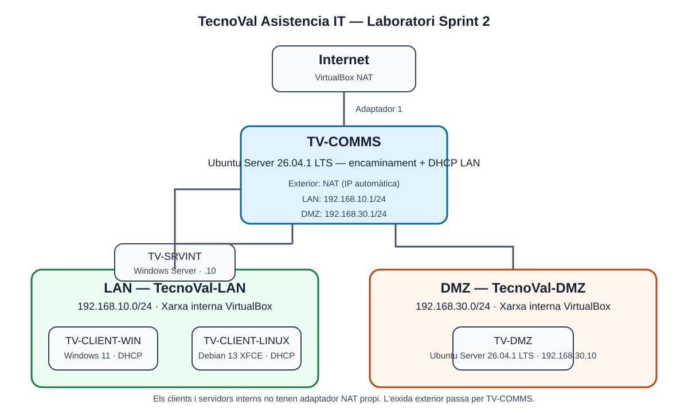

# 3. Configuración de la LAN, la DMZ y el direccionamiento

## 3.1. Redes virtuales de VirtualBox

Crear dos redes de tipo **Red interna** con estos nombres exactos:

- `TecnoVal-LAN`: red interna de los clientes y del servidor interno.
- `TecnoVal-DMZ`: red separada para el servidor de la DMZ.

El servidor de comunicaciones tendrá tres adaptadores: NAT exterior, LAN y DMZ. Las demás máquinas tendrán solo el adaptador de la red que les corresponda.

## 3.2. Adaptadores de cada máquina

| Máquina | Adaptador 1 | Adaptador 2 | Adaptador 3 |
|---|---|---|---|
| TV-COMMS | NAT (exterior) | Red interna: TecnoVal-LAN | Red interna: TecnoVal-DMZ |
| TV-SRVINT | Red interna: TecnoVal-LAN | — | — |
| TV-CLIENT-WIN | Red interna: TecnoVal-LAN | — | — |
| TV-CLIENT-LINUX | Red interna: TecnoVal-LAN | — | — |
| TV-DMZ | Red interna: TecnoVal-DMZ | — | — |

No activar NAT propio en los clientes ni en los servidores internos: la salida exterior debe realizarse a través de TV-COMMS.

## 3.3. Plan IP adaptado al laboratorio

Para este sprint se utilizan dos de las redes del diseño del Sprint 1. La red de servidores del diseño inicial se adapta a una única LAN de laboratorio para simplificar las pruebas. Las demás VLAN (gestión, impresoras e invitados) siguen formando parte del diseño de la empresa, pero no se despliegan en este laboratorio básico.

| Equipo | Interfaz | Red virtual | Modo VirtualBox | IP | Prefijo | Puerta de enlace | DNS |
|---|---|---|---|---|---|---|---|
| TV-COMMS | Exterior | NAT | NAT | Automática | DHCP de VirtualBox | Automática | Automático |
| TV-COMMS | LAN | TecnoVal-LAN | Red interna | 192.168.10.1 | /24 | — | — |
| TV-COMMS | DMZ | TecnoVal-DMZ | Red interna | 192.168.30.1 | /24 | — | — |
| TV-SRVINT | LAN | TecnoVal-LAN | Red interna | 192.168.10.10 | /24 | 192.168.10.1 | Sin DNS corporativo en este sprint |
| TV-CLIENT-WIN | LAN | TecnoVal-LAN | Red interna | DHCP (192.168.10.100–150) | /24 | 192.168.10.1 | No se anuncia DNS en este sprint |
| TV-CLIENT-LINUX | LAN | TecnoVal-LAN | Red interna | DHCP (192.168.10.100–150) | /24 | 192.168.10.1 | No se anuncia DNS en este sprint |
| TV-DMZ | DMZ | TecnoVal-DMZ | Red interna | 192.168.30.10 | /24 | 192.168.30.1 | Sin DNS corporativo en este sprint |

**Nota:** las IP de la tabla son la configuración prevista. Después de configurar las máquinas, hay que sustituirlas si el entorno real obliga a utilizar otros valores y actualizar este documento y el diagrama.

## 3.4. Justificación

- LAN: `192.168.10.0/24`, para los clientes y el servidor interno.
- DMZ: `192.168.30.0/24`, para el servidor situado en la zona separada.
- Las dos redes no se solapan: tienen identificadores de red diferentes.
- TV-COMMS utiliza `.1` como puerta de enlace de cada red.
- Los servidores mantienen IP fijas; los dos clientes obtienen sus IP mediante DHCP.
- En este sprint no se configura DNS corporativo; se implantará en el Sprint 3. Las pruebas se realizarán mediante dirección IP.

## 3.5. Comprobaciones

En Linux:
```bash
hostnamectl
ip -br address
ip route
```

En Windows:
```powershell
hostname
ipconfig /all
route print -4
```

Comprobar que:
1. Los nombres coinciden con la tabla.
2. TV-COMMS tiene tres interfaces y las IP internas previstas.
3. Los clientes solo tienen un adaptador LAN.
4. TV-DMZ solo tiene un adaptador DMZ.
5. No hay direcciones duplicadas.

## 3.6. Diagrama actualizado



El diagrama muestra las conexiones virtuales y las IP previstas. Hay que actualizarlo si cambia la configuración real.

## 3.7. Evidencias

Guardar en `img/sprint-2/` capturas de la configuración de adaptadores de VirtualBox y de los comandos anteriores. Identificar cada captura con el nombre de la máquina. No se deben incluir contraseñas, claves ni datos personales.
